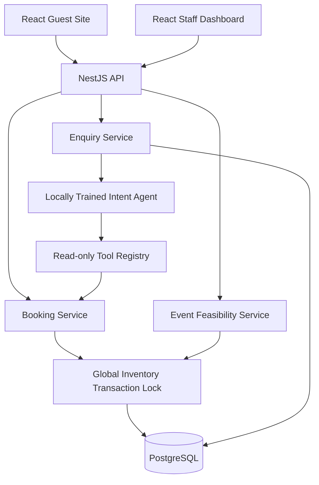
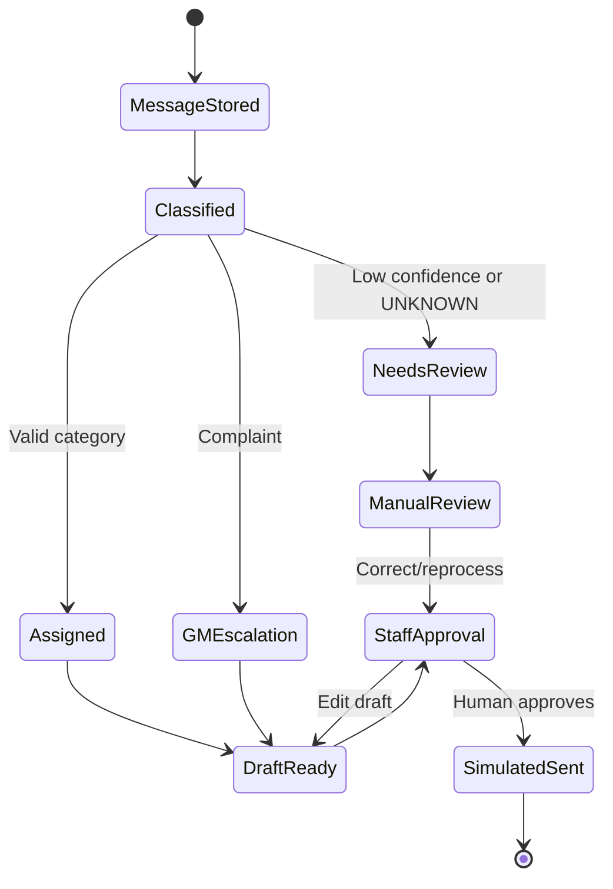

# EstateFlow — Implemented Backend Architecture



## Core invariants

1. **Never double-book a physical room night**: `PRIMARY KEY(room_unit_id, stay_date)`.
2. **Never consume more direct website stock than allotted**: count direct room-nights per type/day before holding, while owning transaction advisory lock.
3. **Never overcommit a resource slot**: sum existing `resource_allocations` and compare with capacity inside the same lock before committing.
4. **Never partially reserve a wedding**: insert bundle, room-nights and non-room allocations in one PostgreSQL transaction.
5. **No AI write authority**: agent tool registry exposes only room availability and requirement reads; send/approve APIs require authenticated staff.
6. **No re-use of expired checkout holds**: expire holds under the same inventory lock before new holds or approval.

## Capacity model (MVP assumption)

Rooms are physical units with daily occupancy; each occupied room-night is unique. Lawn, dining, parking and staff are `resource_slots` keyed by date and `DAY` shift. Slot quantities are admin-set. Event feasibility compares each demand against remaining slot capacity and selects a consistent room-unit set across all nights.

**Limit:** No hourly setup/cleanup overlap, staff skill matrix or off-site vendor availability yet. Product must not claim those are checked.

## Why one advisory lock?

This simplified design serializes all inventory mutations to eliminate check/commit races and deadlocks during the seven-day assignment. At this resort's size and low expected demo concurrency it is pragmatic; later replace with sorted per-resource row locks and exclusion constraints if throughput becomes important. Cross-service/eventual-consistency designs would add avoidable uncertainty.

## Booking sequence

```mermaid
sequenceDiagram
 participant G as Guest
 participant B as Booking Service
 participant DB as PostgreSQL
 G->>B: POST /booking-holds
 B->>DB: BEGIN + advisory lock
 B->>DB: Expire old holds; check allotment, rates, physical rooms
 B->>DB: Insert hold and occupied room_nights
 B->>DB: COMMIT
 G->>B: POST /payments/mock/confirm SUCCESS
 B->>DB: BEGIN + advisory lock
 B->>DB: Recheck active hold and idempotency
 B->>DB: Insert booking, mock payment; confirm hold
 B->>DB: COMMIT
 B-->>G: Booking reference
```

## Event reservation sequence

```mermaid
sequenceDiagram
 participant S as Staff
 participant E as Event Service
 participant DB as PostgreSQL
 S->>E: Evaluate event requirements
 E->>DB: Read room-night + resource capacity
 E-->>S: FEASIBLE / NOT_FEASIBLE / NEEDS_REVIEW
 S->>E: POST approve/reserve
 E->>DB: BEGIN + advisory lock
 E->>DB: Clean holds; re-evaluate all resources
 alt Every requirement passes
  E->>DB: Insert bundle, room nights, service allocations
  E->>DB: COMMIT
  E-->>S: RESERVED
 else Any requirement fails
  E->>DB: ROLLBACK
  E-->>S: 409 + bottlenecks
 end
```

## AI agent state machine



## Risk register / not yet implemented

- No real OTA/PMS reconciliation or external payment processing.
- No privacy retention automation or formal data-protection impact assessment.
- No rate limiting or advanced email validation; add before deployment.
- No browser-automated E2E yet; included API smoke instructions only.
- No production-grade data backup/restore automation.
- Daily service capacity not a workforce roster.
- No separate LLM generative model; local classifier plus grounded template drafts are used.
